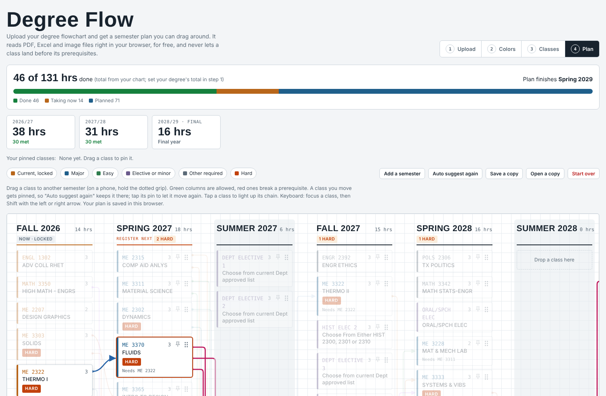

# Degree Flow

**Turn a degree flowchart into a semester plan you can drag around, with every prerequisite checked. Free, private, and no AI service needed.**

Students upload the flowchart their advisor gave them (PDF, Excel, CSV or screenshots). Degree Flow reads every class, its prerequisites and its color right in the browser, asks the student what the colors mean, and builds a semester by semester plan that mixes hard and easy classes and never puts a class before what it needs.



## Features

**Reads flowcharts on its own, for free**
- **Excel (.xlsx):** reads the cells directly, with their exact text, fill colors, bold and merged cells.
- **PDF:** uses the text inside the PDF with its position, then finds the colored box behind each piece of text.
- **Images and scanned PDFs:** free text recognition ([Tesseract](https://github.com/naptha/tesseract.js)) runs in the browser, after a cleanup step that makes dark red text on a red box readable.
- Its own reading rules then find the classes: a box that starts with a course code (or an elective title) is a class, the rest of the box is its name, and the "PR:" lines under it are its prerequisites. Shorthand like "ME 3303, 3370" and "CHEM 1307/1107", and "may be taken concurrently", are understood.
- Overlapping screenshots are merged, and anything that looks misread is flagged for the student to check.

**The student teaches it the colors**
- Advisors color charts differently, so the student names one class they finished, one they're taking now and one they still need. The app learns what each color means.
- Every color found is listed, and the student can set any color by hand, mark a color "ignore," or add their own labels like "Suggested next semester."
- Naming a hard class that's bold makes every bold class count as hard. No color means "still need."

**Plans automatically, then lets the student take over**
- Prerequisites always come first. Long prerequisite chains start early, and fall only and spring only classes stay in their season.
- Each semester mixes an easy class with hard classes spread evenly, up to the student's limit, while aiming for their yearly credit target.
- Drag classes between semesters: columns turn green where a move is allowed and red where it breaks a prerequisite, and a bad drop is blocked with the reason. Moved classes are pinned so "Auto suggest again" keeps them.
- A graduation progress bar, credit totals per academic year, and warnings for heavy or light semesters.
- Plans are saved in the browser automatically, and can be saved to a file and opened again.

## Run it on your computer

Needs [Node.js](https://nodejs.org) 20 or newer. Nothing to install.

```bash
npm start
```

Open http://localhost:3000 and press **Try a sample flowchart**. Run the tests with `npm test`.

## Publish it for free

Degree Flow is a static site: everything runs in the visitor's browser, so hosting costs nothing.

### GitHub Pages (simplest, $0)

1. Push this repository to GitHub.
2. **Settings → Pages → Source: GitHub Actions.**
3. **Actions → Deploy demo to GitHub Pages → Run workflow.** Your site appears at `https://<your-username>.github.io/<repo-name>/`.

### Netlify (also free)

On [Netlify](https://app.netlify.com) choose **Add new project → Import an existing project → GitHub**, pick the repository, and deploy. `netlify.toml` already sets everything.

### Optional AI helper (off by default)

There's an optional helper that turns typed requests ("put Material Science in Spring 2027") into plan rules. It is **off** unless you set `DEGREE_FLOW_AI=on` in your host's environment variables, because it can use paid API credits or Netlify credits. Without it, students pin classes by dragging them. See `.env.example`.

## How it works

```
public/
  index.html, styles.css   the page
  js/app.js                the four steps (upload, colors, classes, plan) and the drag and drop board
  js/planner.js            the planning engine: semesters, prerequisite graph, auto mode, move checks, totals
  js/engine/               the reading engine
    index.js               picks a reader per file and merges pages
    excel.js               Excel and CSV cells
    picture.js             PDF text, images and text recognition
    boxes.js               finds colored boxes, bold text, and cleans images for recognition
    parse.js               the reading rules: classes, names, prerequisites
    colors.js              color names, grouping, Excel theme colors
  vendor/                  bundled libraries (see below), loaded only when needed
  samples/                 the sample flowchart
netlify/functions/claude.mjs  the optional AI helper (off by default)
server.mjs                 local server for `npm start`
tests/                     planner, reading engine and server tests (node:test, no dependencies)
```

**Auto mode** works backward from the last semester to find the latest semester each class can take, then fills semesters in order: urgent classes first, then one easy class, then hard classes up to an even share, then the rest, while respecting prerequisites, hour caps, seasons and pins.

## Credits

Bundled, unchanged, with their licenses in `public/vendor`:
- [pdf.js](https://github.com/mozilla/pdf.js) 4.4.168 by Mozilla, Apache 2.0
- [ExcelJS](https://github.com/exceljs/exceljs) 4.4.0, MIT
- [Tesseract.js](https://github.com/naptha/tesseract.js) 5.1.1 and its English model, Apache 2.0

## License

MIT © Tabassum Peuly
